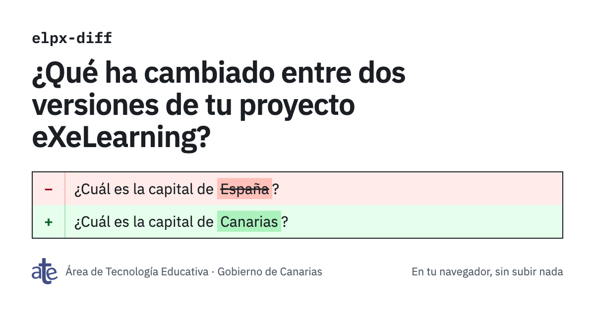

# elpx-diff

[](https://www.npmjs.com/package/elpx-diff)
[](https://github.com/ateeducacion/elpx-diff/actions/workflows/ci.yml)
[](https://ateeducacion.github.io/elpx-diff/)
[](https://codecov.io/gh/ateeducacion/elpx-diff)

[](https://ateeducacion.github.io/elpx-diff/)

[English](README.md)

Muestra qué ha cambiado entre dos versiones de un proyecto de [eXeLearning](https://exelearning.net)
(`.elpx`): páginas, iDevices, metadatos y archivos, en el verde y rojo de un diff de toda la vida.

- **Aplicación web** — <https://ateeducacion.github.io/elpx-diff/>. Se sueltan los dos archivos y
  no se sube nada a ningún servidor.
- **Línea de órdenes** — `npx elpx-diff anterior.elpx nueva.elpx`
- **Biblioteca** — `import { diffElpx } from 'elpx-diff'`
- **Skill para agentes de IA** — [`skills/elpx-diff`](skills/elpx-diff/SKILL.md)

Lee `content.xml` (la fuente editable del paquete), así que compara lo que escribió el autor y no
el HTML generado. Informa de:

- páginas añadidas, eliminadas, renombradas y movidas;
- cajas e iDevices añadidos, eliminados, movidos y editados, con el diff por líneas y palabras de
  su texto (imágenes, multimedia y enlaces incluidos; los datos de los juegos se descodifican);
- propiedades del proyecto (título, autoría, licencia, estilo…);
- archivos añadidos, eliminados, cambiados y renombrados (`content/resources/`).

Las páginas y los iDevices se emparejan por su identificador, y por título y contenido cuando una
herramienta ha regenerado los identificadores.

Cada página del informe indica cuántos de sus iDevices se han añadido, modificado y eliminado.

### Páginas marcadas

Para revisar los cambios tal como los verá el lector, cada página de la comparación en la aplicación
web tiene un enlace **Ver con su diseño**: muestra la página de la versión nueva, tal como eXeLearning la
exportó dentro del `.elpx`, con los cambios marcados en su sitio. Los iDevices añadidos llevan fondo
verde; los modificados, una franja ámbar, sus párrafos nuevos en verde y los retocados en ámbar, y,
justo encima, lo que ha cambiado en ellos, con las palabras quitadas tachadas y las nuevas
resaltadas. Un cartel en una esquina, siempre a la vista, resume los cambios de la página y alterna
entre tres formas de verla, en el mismo iDevice: la **versión anterior**, tal como se exportó
entonces; los **cambios**, con todas las marcas, que es como se abre, y la **versión nueva**; las
dos versiones, tal como las ve el lector. Arriba, un recuadro da lo que no cabe en el cartel, como
el texto de lo eliminado. Una página que la versión nueva eliminó muestra sus cambios sobre su
versión anterior. La ventana ocupa toda la pantalla
del navegador y puede pasar a pantalla completa. La página funciona como para el lector (su menú,
los botones de «saber más», las pestañas…), y sus enlaces a otras páginas las abren allí mismo.

Su código funciona aislado de la aplicación y sin conexión: lo que tendría que descargar de
internet, como un vídeo incrustado, no aparece. La línea de órdenes da la web marcada entera en un
ZIP (`--marked`), con `elpx-diff.html`, una página de resumen con todas las páginas que cambian, de
más a menos cambios; allí, el cartel quita y pone las marcas.

## Línea de órdenes

```sh
elpx-diff anterior.elpx nueva.elpx                       # informe en color en la terminal
elpx-diff anterior.elpx nueva.elpx --json                # un documento JSON
elpx-diff anterior.elpx nueva.elpx --html -o cambios.html  # informe HTML autónomo, sin scripts
elpx-diff anterior.elpx nueva.elpx --marked marcada.zip    # además, la web marcada en un ZIP
elpx-diff textconv proyecto.elpx                         # un proyecto como texto plano
```

`--lang es|en` elige el idioma (por defecto, el de `LANG`) y `--no-color` quita los colores.
Código de salida: `0` sin diferencias, `1` con diferencias, `2` error.

### Git

```sh
git config diff.elpx.textconv "elpx-diff textconv"
echo "*.elpx diff=elpx" >> .gitattributes
```

A partir de ahí `git diff`, `git log -p` y `git show` enseñan los cambios de los `.elpx` como texto.

## Límites

- No admite proyectos `.elp` antiguos (eXeLearning 2.x): hay que guardarlos antes como `.elpx`.
- No admite ZIP64 (archivos de más de 4 GiB).
- La comparación es textual. Los cambios que solo afectan al formato se señalan, sin detalle.

El resto (biblioteca, seguridad, desarrollo y publicación) está en el [README en inglés](README.md).

## Licencia

[AGPL-3.0-or-later](LICENSE). Creado por el Área de Tecnología Educativa (ATE) del Gobierno de Canarias.
