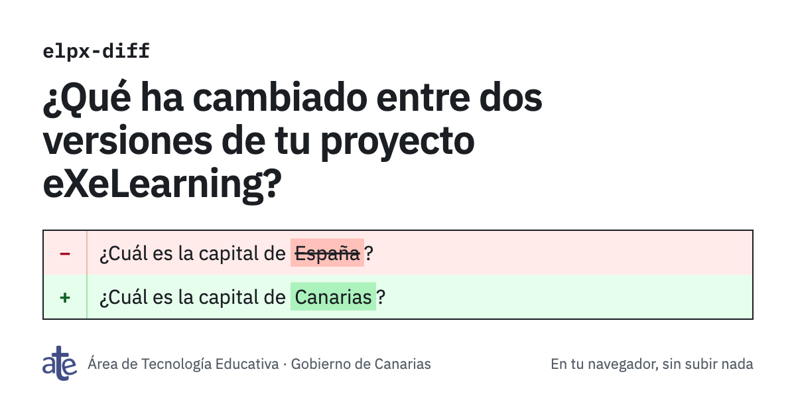

# elpx-diff

[](https://www.npmjs.com/package/elpx-diff)
[](https://github.com/ateeducacion/elpx-diff/actions/workflows/ci.yml)
[](https://ateeducacion.github.io/elpx-diff/)
[](https://codecov.io/gh/ateeducacion/elpx-diff)

[](https://ateeducacion.github.io/elpx-diff/)

[Español](README.es.md)

See what changed between two versions of an [eXeLearning](https://exelearning.net) project
(`.elpx`): pages, iDevices, metadata and files, in the green and red of a normal diff.

- **Web app** — <https://ateeducacion.github.io/elpx-diff/>. Drop two files; nothing is uploaded.
- **CLI** — `npx elpx-diff old.elpx new.elpx`
- **Library** — `import { diffElpx } from 'elpx-diff'`
- **Agent Skill** — [`skills/elpx-diff`](skills/elpx-diff/SKILL.md)

It reads `content.xml` (the editable source inside the package), so it compares what the author
wrote, not the generated HTML. It reports:

- pages added, removed, renamed and moved;
- boxes and iDevices added, removed, moved and edited, with a line and word diff of their text
  (images, media and links included; game data decoded);
- project properties (title, author, licence, theme…);
- files added, removed, changed and renamed (`content/resources/`, by size and CRC-32).

Pages and iDevices are matched by id, and by title and content when a tool regenerated the ids.
Fields that change on every save (`pp_modified`, the embedded screenshot) are ignored.

Each page of the report says how many of its iDevices were added, modified and removed.

### Marked pages

To review the changes as readers will see them, the web app shows the comparison in three ways:
**Text**, **Two columns** and **With its design**. The last one shows each page as eXeLearning
exported it inside the `.elpx`, with the changes marked in place. Added iDevices have a green
background; modified ones an amber bar, their new paragraphs in green and their edited ones in amber,
and, right above them, what changed in them, the removed words struck through and the new ones
highlighted. Above the page, its changes are counted and three buttons switch between the **old**
version as it was exported then, the **changes** (the default, with all the marks) and the **new**
version, both as readers see them, landing on the same iDevice. A box at the top of the page gives
what does not fit there, such as the text of what was removed. The page works as it does for readers
(its "show more" buttons, tabs…) and its own menu leads from page to page: there, the pages that
changed are marked, the ones the new version added are in green, and the ones it removed, in red and
struck through. The viewer can go full screen.

Its scripts run cut off from the app (see [Safety](#safety)): whatever they would fetch from the
internet, such as an embedded video, does not show. The CLI gives the whole marked website as a ZIP
(`--marked`), with `elpx-diff.html`, a summary page that lists every page with changes, the most
changed first. There, a bar in a corner of each page does what the app does above it: it sums up the
page's changes and switches between the three versions.

## CLI

```sh
elpx-diff old.elpx new.elpx                    # coloured report in the terminal
elpx-diff old.elpx new.elpx --json             # one JSON document
elpx-diff old.elpx new.elpx --html -o diff.html  # self-contained report, no scripts
elpx-diff old.elpx new.elpx --marked marked.zip  # also the marked website, as a ZIP
elpx-diff textconv project.elpx                # one project as plain text
```

`--lang es|en` chooses the language (default: from `LANG`); `--no-color` turns colours off. Exit
status: `0` no differences, `1` differences, `2` error.

### Git

```sh
git config diff.elpx.textconv "elpx-diff textconv"
echo "*.elpx diff=elpx" >> .gitattributes
```

`git diff`, `git log -p` and `git show` then show `.elpx` changes as text. For the full report
on one file: `GIT_EXTERNAL_DIFF=elpx-diff git diff -- project.elpx`.

## Library

```ts
import { diffElpx, markProject, renderHtml, renderReport, renderText } from 'elpx-diff';

const diff = await diffElpx(oldFile, newFile); // File, Blob or Uint8Array
const marked = await markProject(oldFile, newFile, { lang: 'en' }); // marked.diff is the comparison
await marked.page(marked.diff.pages[0]); // one page, marked and self-contained: it carries the project's scripts, show it only in a sandboxed frame
await marked.site(); // the whole marked website, ZIP bytes
diff.summary; // { added, modified, removed }
renderText(diff, { lang: 'en', color: true }); // terminal
renderHtml(diff, 'en'); // HTML fragment (project text is always escaped)
renderReport(diff, 'en'); // whole HTML page
```

Runs in browsers, Node 22.18+ and Bun. Files are read with ranged reads: only `content.xml` is
inflated, so projects with large videos compare quickly. A marked page reads only its own files, and
only when it is asked for.

## Safety

Everything inside an `.elpx` is treated as untrusted data. The comparison reads project HTML as
text, and the report escapes every piece of it. The web app has a Content-Security-Policy that
allows no connection to other origins.

The one place where a project's page is rendered, and its scripts run, is the viewer of marked
pages: `viewer.html`, in a frame sandboxed with `allow-scripts` but without `allow-same-origin`. The
page gets an origin of its own, so it cannot reach the app, nor what other pages of the same site
keep in the browser; and `viewer.html`'s own policy gives it no network at all, so it cannot send
anything anywhere. Everything it needs comes inlined in the one message the app posts to it. Its
links to other pages come back to the app as messages, which the app follows only to pages of the
same project; links out do not open, since a pop-up could carry the project's text away.

## Limits

- Legacy `.elp` projects (eXeLearning 2.x) are not supported: save them as `.elpx` first.
- No ZIP64 (archives over 4 GiB).
- The comparison is textual. Formatting-only changes are flagged as such, without detail.

## Development

```sh
bun install
bun run dev        # web app with reload
bun run cli a.elpx b.elpx
bun run check      # bun lint + bun fmt --check, bun check (types), bun test --coverage
bun run fix        # apply lint fixes and format
bun run build      # dist/: index.js + types, cli.js, web/ (with the two manuals of its example, downloaded once)
```

Everything runs on Bun (canary in CI): `bun lint`, `bun fmt`, `bun check`, `bun test` and
`bun build --dts`; there is no TypeScript, ESLint, Prettier or Vitest package. Tests cover every
module, the web page included (in a DOM, `test/web.test.ts`), and `bun test --coverage` fails when
a file covers under 90 % of its lines or functions. `bun.lock` stays at `lockfileVersion` 1 for
Dependabot (`bun run check:lockfile`).

`src/zip.ts` lists the archive, `src/model.ts` reads `content.xml`, `src/text.ts` turns iDevice
content into lines, `src/diff.ts` compares, `src/render.ts` and `src/report.ts` print. The web app
(`src/web`) and the HTML report share one renderer and one style sheet.

### Publishing

Every push to `main` deploys the web app to GitHub Pages (`pages.yml`). A published GitHub release
publishes the package to npm (`release.yml`, trusted publishing, when the repository variable
`NPM_PUBLISH` is `true`): bump `version` in `package.json` first, since the release tag must match it.

## Licence

The web app embeds the IBM Plex Sans and IBM Plex Mono typefaces (SIL Open Font License 1.1).

[AGPL-3.0-or-later](LICENSE). Made by the Área de Tecnología Educativa (ATE), Gobierno de Canarias.
